# System Documentation – Marquee ระบบรีวิวภาพยนตร์ออนไลน์

ผู้จัดทำ: Rapeephat Lanthong (รหัสนักศึกษา 674245030)
รายวิชา: Internet Programming

## สารบัญ
1. [System Overview](#1-system-overview)
2. [User Roles](#2-user-roles)
3. [Functional Requirements](#3-functional-requirements)
4. [User Flow](#4-user-flow)
5. [Site Map](#5-site-map)
6. [Screenshots](#6-screenshots)
7. [วิธีการใช้งานระบบ](#7-วิธีการใช้งานระบบ)

---

## 1. System Overview

### 1.1 ระบบคืออะไร
Marquee เป็น Web Application สำหรับรีวิวภาพยนตร์ ผู้ใช้สามารถค้นหาและดูข้อมูลภาพยนตร์ ให้คะแนน เขียนรีวิว และบันทึกหนังที่ชอบไว้ในรายการของตนเอง ส่วนผู้ดูแลระบบสามารถจัดการข้อมูลภาพยนตร์ รีวิว และสมาชิกได้

### 1.2 ระบบแก้ปัญหาอะไร
ผู้ที่ต้องการดูภาพยนตร์ต้องค้นหาข้อมูล คะแนน และความคิดเห็นจากหลายแหล่ง ระบบนี้รวบรวมข้อมูลหนัง คะแนนเฉลี่ย และรีวิวของผู้ใช้ไว้ในที่เดียว ทำให้ค้นหาและเปรียบเทียบได้สะดวกขึ้น

### 1.3 ขอบเขตของระบบ
**ทำได้:** แสดง/ค้นหา/กรอง/เรียงลำดับหนัง, สมัครสมาชิกและเข้าสู่ระบบ, ให้คะแนนและรีวิว, รายการโปรด, ตัวอย่างหนัง, จัดการข้อมูลโดย Admin, Dashboard สถิติ
**ไม่รวม:** ระบบชำระเงิน การจองตั๋ว การอัปโหลดไฟล์ผ่านหน้าเว็บ (ใช้ลิงก์/ไฟล์ในโฟลเดอร์ `public/`) การรีเซ็ตรหัสผ่านทางอีเมล

### 1.4 สถาปัตยกรรมระบบ (Client–Server)
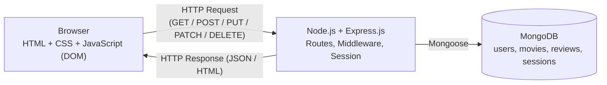

### 1.5 เทคโนโลยีและการใช้งาน
| เทคโนโลยี | ใช้ที่ไหน |
|---|---|
| HTML5 | `public/*.html` โครงสร้างทุกหน้า |
| CSS3 | `public/css/style.css` การ์ดหนัง แถวเลื่อน โหมดสว่าง/มืด (CSS Variables) |
| JavaScript + DOM | `public/js/*.js` เรียก API ด้วย `fetch` แล้วสร้างการ์ด/รีวิวด้วย DOM, ค้นหาแบบ debounce, ให้ดาว, Dialog ตัวอย่างหนัง, ตรวจสอบฟอร์ม |
| Node.js + Express.js | `app.js`, `routes/*.js` Server, Routing, REST API, Middleware |
| MongoDB + Mongoose | `models/*.js` เก็บข้อมูล, `lib/movieStats.js` คำนวณคะแนนเฉลี่ยด้วย Aggregation |
| Session | `express-session` + `connect-mongo` เก็บสถานะ Login |
| Cookies | `theme`, `recent`, `connect.sid` |

### 1.6 โครงสร้างข้อมูล (MongoDB)
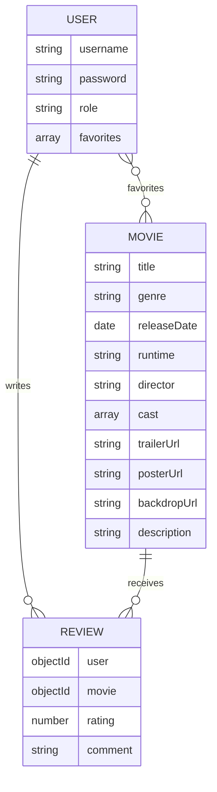
- `reviews` มี unique index (user, movie) ทำให้ 1 คนรีวิวได้ 1 ครั้งต่อ 1 หนัง
- รหัสผ่านเก็บเป็น bcrypt hash ไม่เก็บรหัสจริง

### 1.7 การจัดการสถานะผู้ใช้ (Session / Cookies)
| ชนิด | ชื่อ | ค่าที่เก็บ | อายุ | ใช้ทำอะไร |
|---|---|---|---|---|
| Session (ฝั่ง Server, เก็บใน MongoDB) | – | `{ id, username, role }` | 2 ชม. | ตรวจสอบ Login และสิทธิ์ Admin |
| Cookie | `connect.sid` | Session ID | 2 ชม. | บอก Server ว่าเป็น Session ของใคร |
| Cookie | `theme` | `dark` / `light` | 30 วัน | จำโหมดสว่าง/มืด |
| Cookie | `recent` | id หนังที่เปิดดูล่าสุด (สูงสุด 10) | 30 วัน | แถว "Recently viewed" |

---

## 2. User Roles
| บทบาท | การเข้าถึง | สิ่งที่ทำได้ |
|---|---|---|
| ผู้ใช้ทั่วไป (Guest) | ไม่ต้อง Login | ดูรายการหนัง ค้นหา กรอง เรียง ดูรายละเอียด ตัวอย่างหนัง คะแนนและรีวิว สมัครสมาชิก / เข้าสู่ระบบ |
| สมาชิก (User) | Login แล้ว | ทุกอย่างของ Guest + ให้คะแนน เขียน/แก้ไข/ลบรีวิวของตนเอง เพิ่ม/ลบรายการโปรด ดูรายการโปรดและประวัติรีวิว |
| ผู้ดูแลระบบ (Admin) | Login ด้วยบัญชี Admin | จัดการหนัง (เพิ่ม/แก้ไข/ลบ) ลบรีวิวของทุกคน เปลี่ยนสิทธิ์/ลบสมาชิก ดู Dashboard |

การตรวจสอบสิทธิ์ทำที่ **ฝั่ง Server** ด้วย Middleware `requireLogin` (ไม่ได้ Login → 401) และ `requireAdmin` (ไม่ใช่ Admin → 403) และหน้า `/admin.html` จะ redirect ไปหน้า Login หากไม่ใช่ Admin

---

## 3. Functional Requirements
| รหัส | ฟังก์ชัน | ผู้ใช้ | รายละเอียด |
|---|---|---|---|
| FR-01 | แสดงรายการภาพยนตร์ | ทุกคน | แบนเนอร์หนังแนะนำ และแถว Top rated / New releases / แยกประเภท |
| FR-02 | ค้นหาภาพยนตร์ | ทุกคน | ค้นหาตามชื่อ (ไม่สนตัวพิมพ์ใหญ่เล็ก) |
| FR-03 | กรองตามประเภท | ทุกคน | Action, Horror, Comedy ฯลฯ |
| FR-04 | เรียงลำดับ | ทุกคน | ตามคะแนน / วันที่ออกฉาย / ชื่อ |
| FR-05 | ดูรายละเอียดภาพยนตร์ | ทุกคน | ผู้กำกับ นักแสดง ความยาว สโลแกน เรื่องย่อ ตัวอย่างหนัง |
| FR-06 | แสดงคะแนนเฉลี่ย | ทุกคน | คำนวณจากรีวิวทั้งหมดด้วย Aggregation พร้อมจำนวนรีวิว |
| FR-07 | สมัครสมาชิก | Guest | ตรวจสอบ username 3–30 ตัวอักษร, รหัสผ่านอย่างน้อย 6 ตัว, username ไม่ซ้ำ, ยืนยันรหัสผ่าน |
| FR-08 | เข้าสู่ระบบ / ออกจากระบบ | ทุกคน | สร้าง/ทำลาย Session |
| FR-09 | ให้คะแนนและเขียนรีวิว | สมาชิก | 1–5 ดาว + ความคิดเห็น (1 รีวิวต่อ 1 หนัง) |
| FR-10 | แก้ไข/ลบรีวิวของตนเอง | สมาชิก | แก้ไขได้เฉพาะรีวิวของตนเอง |
| FR-11 | รายการโปรด | สมาชิก | เพิ่ม/ลบหนังในรายการโปรด |
| FR-12 | หน้า My list | สมาชิก | ดูรายการโปรดและประวัติรีวิวของตนเอง |
| FR-13 | Recently viewed | ทุกคน | จำหนังที่เปิดดูล่าสุดด้วย Cookie `recent` |
| FR-14 | เปลี่ยนโหมดสว่าง/มืด | ทุกคน | จำค่าด้วย Cookie `theme` |
| FR-15 | จัดการภาพยนตร์ | Admin | เพิ่ม แก้ไข ลบ (ลบหนังจะลบรีวิวและรายการโปรดที่เกี่ยวข้องด้วย) |
| FR-16 | จัดการรีวิว | Admin | ดูและลบรีวิวทั้งหมด |
| FR-17 | จัดการสมาชิก | Admin | เปลี่ยนสิทธิ์ user/admin, ลบสมาชิก (ห้ามแก้/ลบตัวเอง) |
| FR-18 | Dashboard | Admin | จำนวนหนัง/สมาชิก/รีวิว, คะแนนเฉลี่ย, กราฟคะแนนและประเภท, หนังคะแนนสูงสุด, หนังที่ถูกใจที่สุด |
| FR-19 | ตรวจสอบสิทธิ์ฝั่ง Server | ระบบ | 401 เมื่อยังไม่ Login, 403 เมื่อไม่มีสิทธิ์ |

### ตัวอย่างการทำงาน Client–Server: การให้คะแนนรีวิว
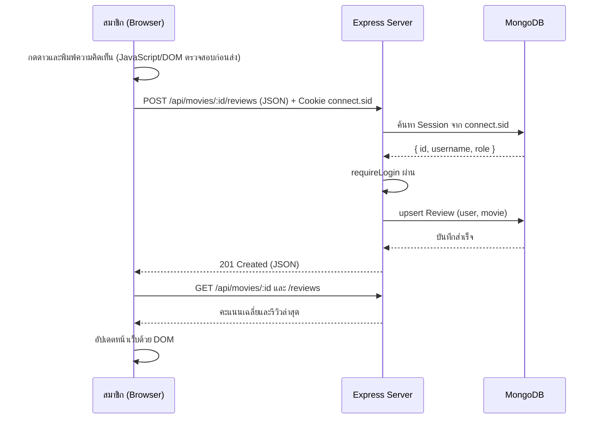

---

## 4. User Flow

### 4.1 ผู้ใช้ทั่วไป / สมาชิก
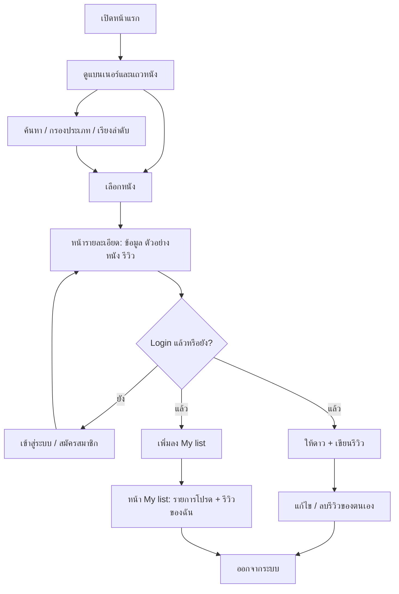

### 4.2 ผู้ดูแลระบบ
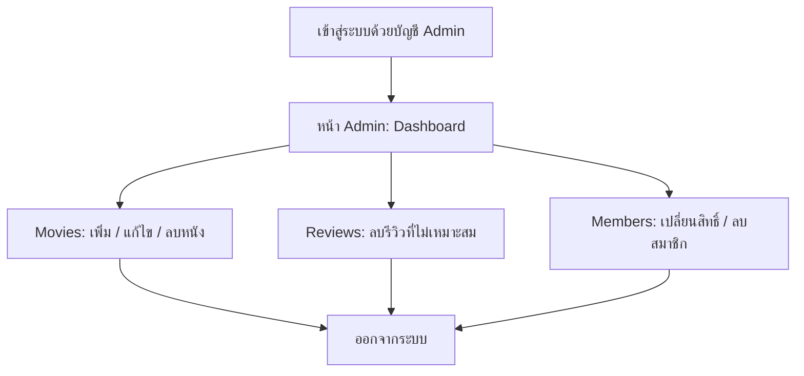

---

## 5. Site Map
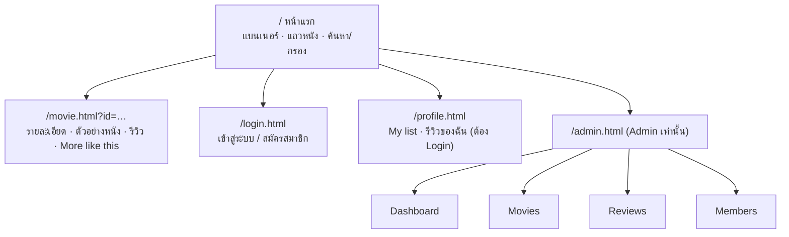

---

## 6. Screenshots
> ใส่ไฟล์ภาพไว้ที่ `docs/screenshots/` ตามชื่อด้านล่าง แล้วภาพจะแสดงในเอกสารนี้อัตโนมัติ

### 6.1 หน้าแรก
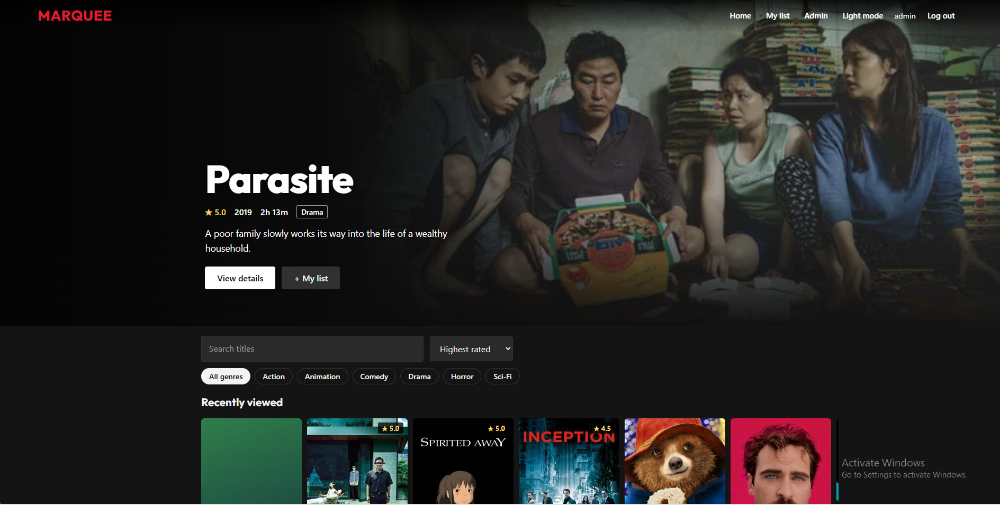

### 6.2 ผลการค้นหา / กรองประเภท
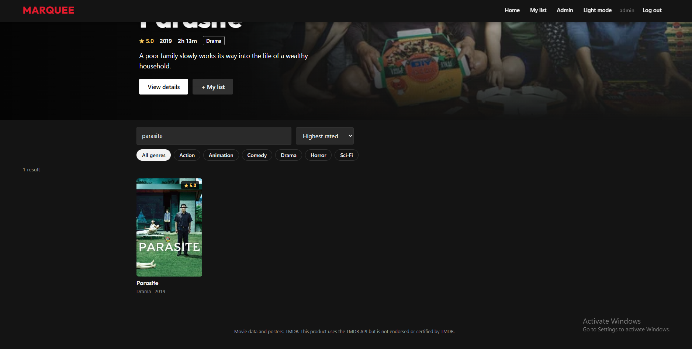

### 6.3 หน้ารายละเอียดภาพยนตร์
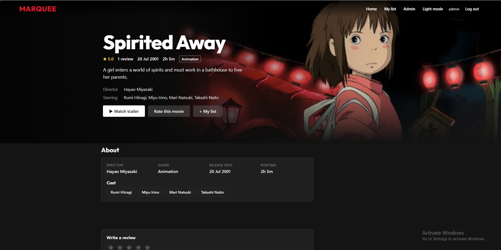

### 6.4 ตัวอย่างหนัง (Trailer)
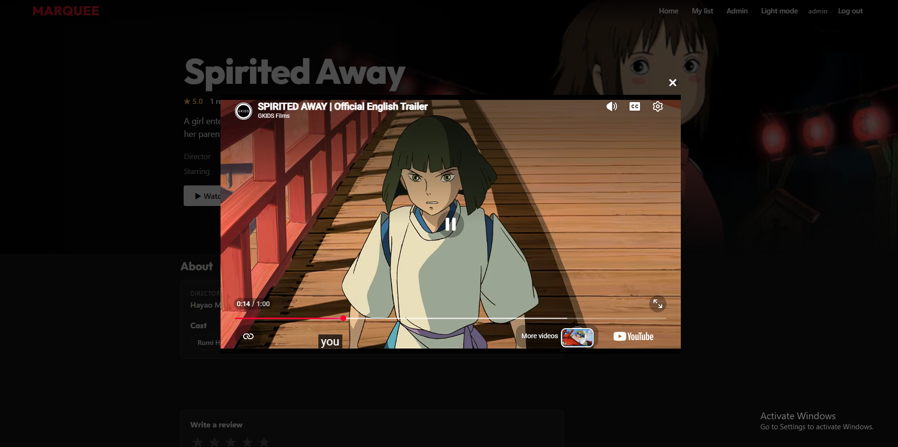

### 6.5 เข้าสู่ระบบ / สมัครสมาชิก
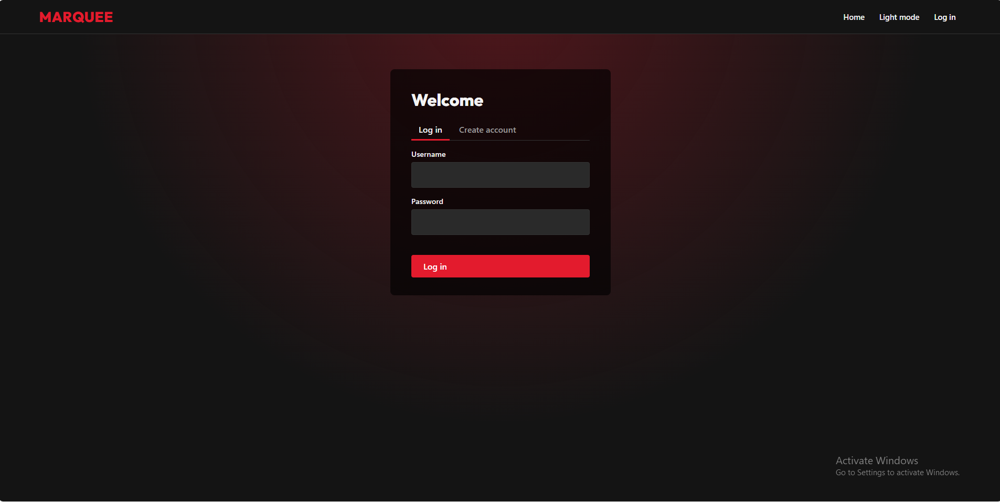

### 6.6 เขียนรีวิวและให้คะแนน
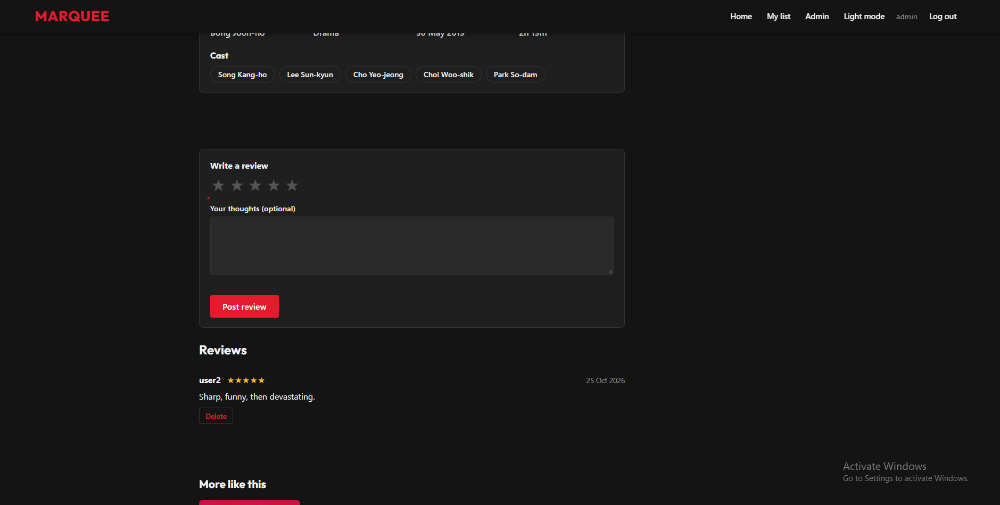

### 6.7 My list
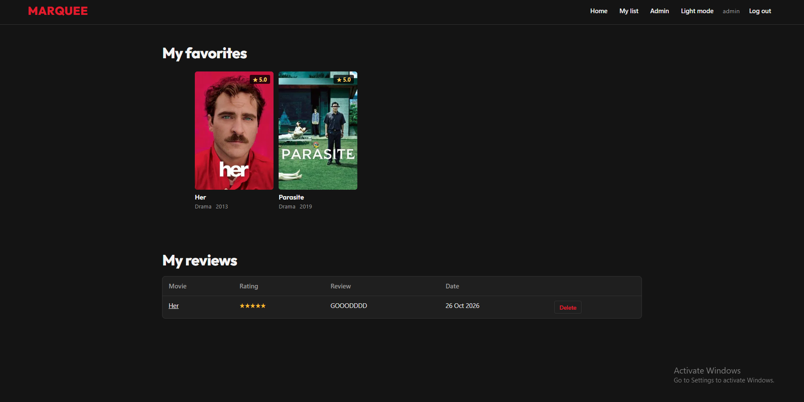

### 6.8 โหมดสว่าง (Light mode)
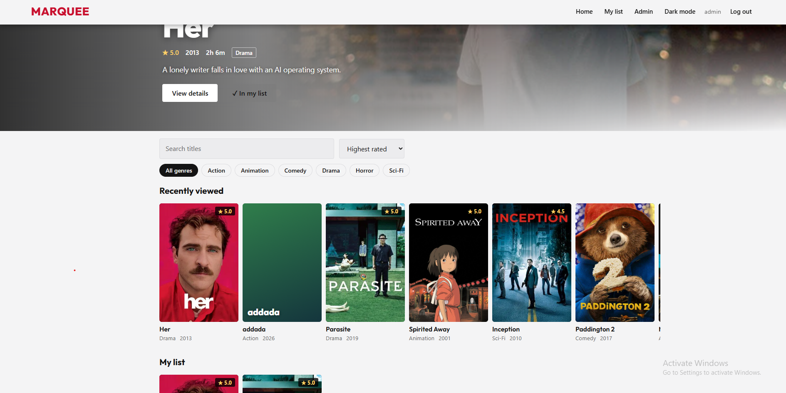

### 6.9 Admin: Dashboard
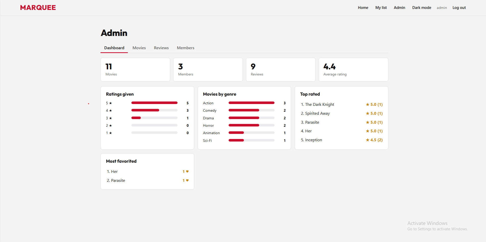

### 6.10 Admin: เพิ่ม/แก้ไขภาพยนตร์
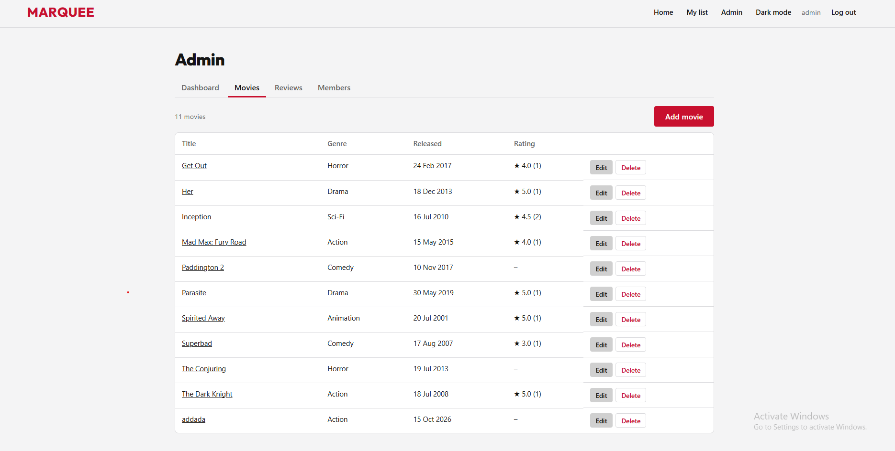

### 6.11 Admin: จัดการสมาชิก
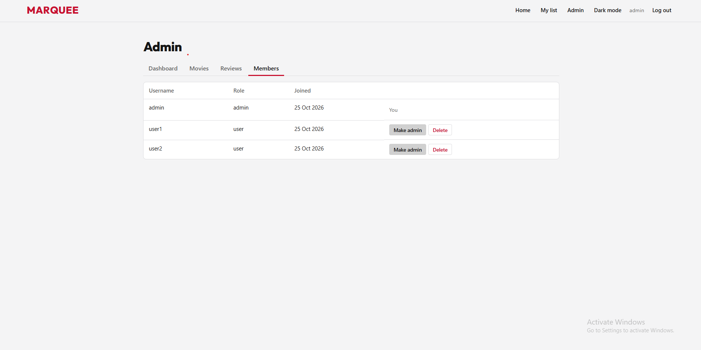

### 6.12 Cookies และ Session (DevTools / MongoDB Compass)
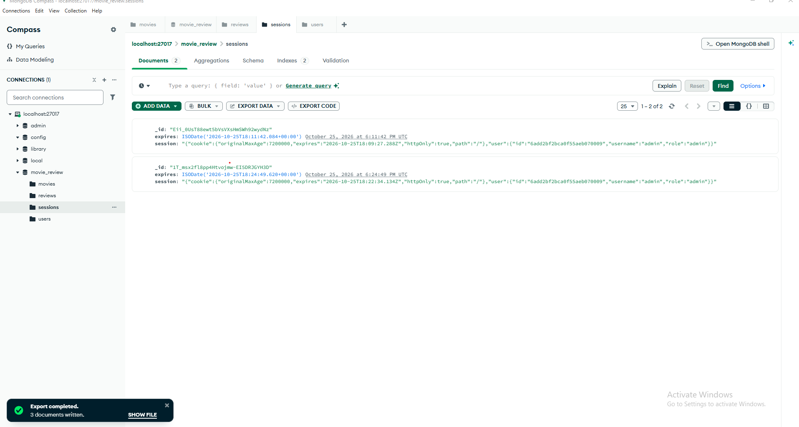

---

## 7. วิธีการใช้งานระบบ

### 7.1 เริ่มใช้งาน
1. ติดตั้ง Node.js และ MongoDB แล้วรัน `npm install`
2. ตั้งค่า `.env` (ดู README.md) แล้วรัน `npm run seed`
3. รัน `npm start` และเปิด `http://localhost:3000`

บัญชีทดสอบ: Admin `admin` / `admin123`, สมาชิก `user1` / `user123`

### 7.2 ผู้ใช้ทั่วไป
1. **ดูหนัง:** หน้าแรกเลื่อนแถวซ้าย/ขวาด้วยปุ่มลูกศร
2. **ค้นหา:** พิมพ์ชื่อหนังในช่อง Search
3. **กรองและเรียง:** กดปุ่มประเภท (เช่น Action) และเลือกการเรียงลำดับ
4. **ดูรายละเอียด:** คลิกการ์ดหนัง ดูข้อมูล ผู้กำกับ นักแสดง และกด "Watch trailer"
5. **สมัครสมาชิก:** กด Log in → แท็บ Create account → กรอกชื่อผู้ใช้และรหัสผ่าน
6. **เปลี่ยนโหมด:** กดปุ่ม Dark mode / Light mode บนแถบเมนู

### 7.3 สมาชิก
1. **ให้คะแนนและรีวิว:** เปิดหน้าหนัง → กดดาว 1–5 → พิมพ์ความคิดเห็น → Post review
2. **แก้ไขรีวิว:** เปิดหน้าหนังเดิม แก้ไขในกล่องรีวิว แล้วกด Save changes
3. **ลบรีวิว:** กด Delete ใต้รีวิวของตนเอง
4. **รายการโปรด:** กด "+ My list" ที่หน้าหนัง (กดซ้ำเพื่อนำออก)
5. **ดูรายการของฉัน:** เมนู My list จะแสดงรายการโปรดและรีวิวทั้งหมดของตนเอง
6. **Recently viewed:** หนังที่เปิดดูล่าสุดจะแสดงเป็นแถวบนสุดของหน้าแรก
7. **ออกจากระบบ:** กด Log out

### 7.4 ผู้ดูแลระบบ
1. Login ด้วยบัญชี Admin แล้วเลือกเมนู **Admin**
2. **Dashboard:** ดูสถิติรวมของระบบ
3. **Movies:** กด Add movie เพื่อเพิ่มหนัง กรอกชื่อ ประเภท วันที่ออกฉาย ผู้กำกับ นักแสดง (คั่นด้วยคอมมา) รูปโปสเตอร์/แบนเนอร์ ความยาว (เช่น `1h 30m`) ตัวอย่างหนัง แล้วกด Save
   - แก้ไข: กด Edit | ลบ: กด Delete (จะลบรีวิวของหนังเรื่องนั้นด้วย)
4. **Reviews:** กด Delete เพื่อลบรีวิวที่ไม่เหมาะสม
5. **Members:** กด Make admin / Make member เพื่อเปลี่ยนสิทธิ์ หรือ Delete เพื่อลบสมาชิก

### 7.5 การเพิ่มรูปและวิดีโอ
- รูปโปสเตอร์ (แนวตั้ง 2:3) และแบนเนอร์ (แนวนอน 16:9) ใส่เป็นลิงก์ หรือวางไฟล์ใน `public/images/` แล้วใช้ path เช่น `/images/inception-poster.jpg`
- ตัวอย่างหนังใส่ลิงก์ YouTube หรือวางไฟล์ `.mp4` ใน `public/videos/` แล้วใช้ path เช่น `/videos/inception.mp4`
